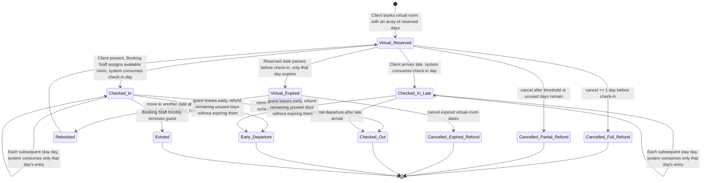
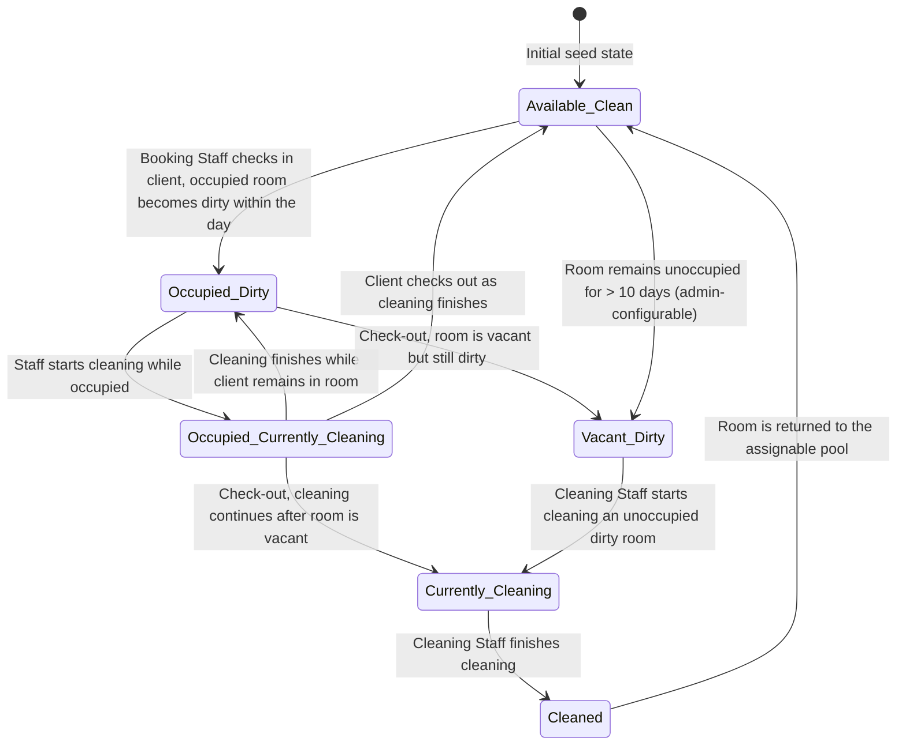
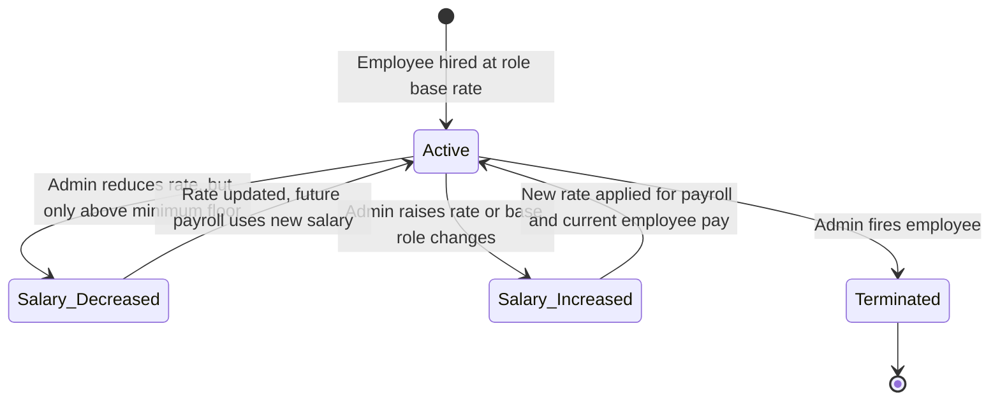

# System State Machines — HotelTrivago

Defines the lifecycles and state transitions for Reservations, Virtual Room objects, Payment Captures, Physical Rooms, and Housekeeping status to complement `ST-1` (Password Reset) and `ST-2` (User Session) in the M3 Test Plan.

---

## 1. ST-3 — Reservation & Virtual Room Lifecycle

The lifecycle states apply to the booking's remaining reserved-day entries. `virtual_reserved` is an array containing one entry per reserved day. Conversion or pre-check-in expiration removes only the affected day from the active array, while the booking and its history remain. Room assignment is check-in and requires the client to be physically present. Once checked in, reserved days cannot expire; early departure refunds unused remaining days instead.

| State | Description | Financial / Inventory Impact |
| :--- | :--- | :--- |
| `Virtual_Reserved` | Reservation exists as a virtual room object with one active array entry per reserved day. | Client pays for the reservation; counts toward room-type capacity. |
| `Checked_In` | Client is physically present and Booking Staff assigns them to a physical room available for at least the same number of consecutive stay days. | Assignment/check-in immediately consumes the current day's virtual entry, which is not refundable. The system consumes only one matching entry on each subsequent stay day. |
| `Cancelled_Full_Refund` | Cancelled at least 1 day before `check_in`. | Inventory released; 100% refund. |
| `Cancelled_Partial_Refund` | Cancelled after the free-cancellation window or with remaining unused virtual-room days. | Inventory released; refund uses `unused_day_refund_rate` for unused, non-expired days. |
| `Virtual_Expired` | A reserved date passed without conversion before check-in. | Only that day expires and can be rebooked at `expired_day_rebooking_rate` times its day rate. No day expires after check-in. |
| `Cancelled_Expired_Refund` | Client cancels an expired virtual-room date. | Refund uses `expired_day_refund_rate`. |
| `Checked_In_Late` | Guest arrives after expected check-in. | Lost days are refunded at `expired_day_refund_rate`. |
| `Early_Departure` | Guest leaves before scheduled `check_out`. | Refund remaining unused days at `unused_day_refund_rate`; do not expire them. The check-in day already consumed is not refundable. |
| `Checked_Out` | Guest leaves on schedule. | Room queued for cleaning. |
| `Evicted` | Booking Staff forcibly removes guest. | Room queued for cleaning. |

---

## 2. ST-4 — Physical Room Status & Housekeeping Lifecycle

The default check-in window is **3:00 PM–10:00 PM**, and the default check-out window is **7:00 AM–1:00 PM**. Admins can change these windows. If checkout is not completed by the end of its window, Booking Staff may charge an extra night manually; the system does not charge it automatically. A physical room is assignable only after checkout and cleaning are both complete.

| State | Description | Permitted Actor Transition |
| :--- | :--- | :--- |
| `available_clean` | Room is empty, checkout is complete, and cleaning is complete; assignable for a new guest. | `booking_staff`, `admin` |
| `occupied_dirty` | Occupied rooms are always treated as dirty unless currently being cleaned. | `cleaning_staff`, `booking_staff`, `admin` |
| `occupied_currently_cleaning` | Cleaning is underway while the room remains occupied. | `cleaning_staff`, `admin` |
| `vacant_dirty` | Unoccupied room is dirty, including after checkout when cleaning is still required; not assignable until cleaned. | `cleaning_staff`, `booking_staff`, `admin` |
| `currently_cleaning` | Room being cleaned while empty or in a housekeeping sequence. | `cleaning_staff`, `admin` |
| `cleaned` | Housekeeping finished for an unoccupied room after checkout; room can return to the assignable pool. | `cleaning_staff`, `admin` |

### Dirty Room Timing Rule
- **Occupied rooms** become dirty within the same day (hardcoded behavior).
- **Unoccupied rooms** remain clean until they exceed the admin-configurable `dirty_after_days` threshold (default: **10 days**).
- Occupancy and cleanliness are tracked separately, but an occupied room is never clean; it is dirty or currently cleaning.

---

## 3. ST-5 — Staff Salary Adjustment Lifecycle

| State | Description | Rule |
| :--- | :--- | :--- |
| `Active` | Employee is currently paid and can work. | Base salary changes may update employee pay depending on direction. |
| `Salary_Decreased` | Admin decreases an employee's pay but keeps it above the minimum role floor. | Allowed only as a manual correction; not retroactive for role base changes. |
| `Salary_Increased` | Admin raises pay or the base role salary increases. | Active employees tied to the base rate are updated to the new base value. |
| `Terminated` | Employee is deactivated and payroll stops. | Fired staff lose portal access immediately. |

**Rule summary:**
- Decreasing the role base rate does not change existing employees' salaries.
- Increasing the role base rate does update employees still tied to that base rate.
- Individual employee reductions are allowed only above the role's minimum salary floor.
