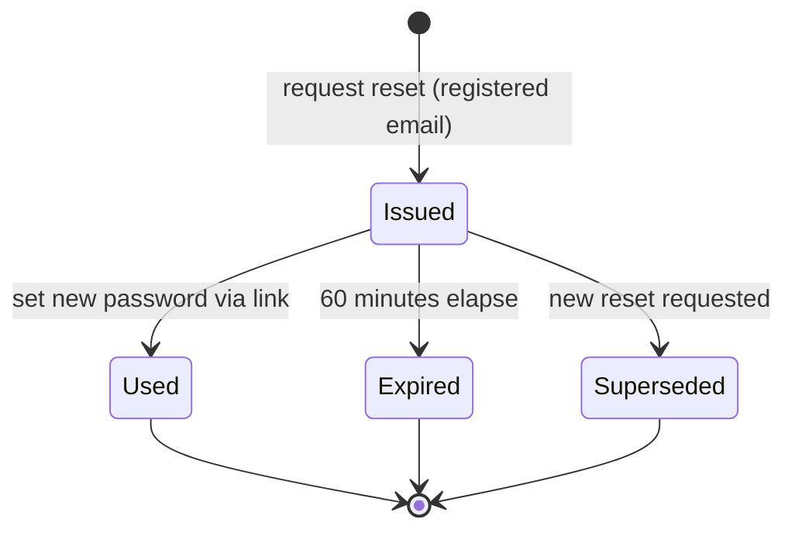
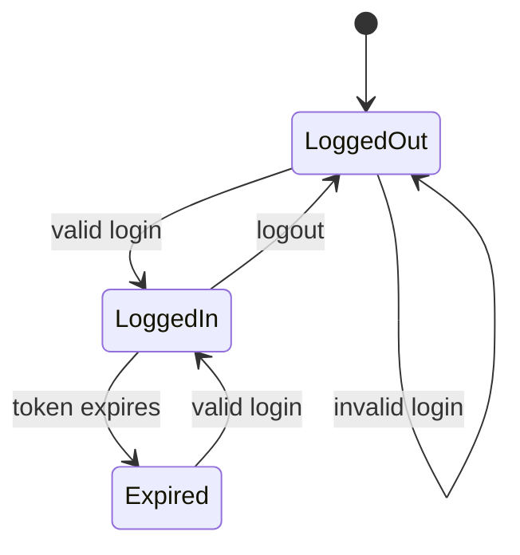

# Test Plan — HotelTrivago

**Milestone**: M3 — Black Box Testing
**Author**: Gilberto Anaya Mercado (QA Lead)
**Last updated**: 2026-11-01
**Status**: Draft — pending team review

See the [Test Strategy](./test-strategy.md) for scope, levels, environments and entry/exit criteria.

---

## 1. Features to Test

Feature IDs reuse the requirement IDs from the specification.

| Feature ID | Feature                                   | Priority | Portal   | Test Techniques             | Test Cases                     |
| ---------- | ----------------------------------------- | -------- | -------- | --------------------------- | ------------------------------ |
| FR-1       | User registration                         | High     | Client   | EP, BVA                     | TC-001 – TC-004                |
| FR-2       | Login / logout                            | High     | Both     | EP, ST                      | TC-005, TC-006, TC-023         |
| FR-3       | Password reset via email link             | Medium   | Client   | ST                          | TC-007, TC-008, TC-023         |
| FR-4       | Search rooms by dates, guests, rooms      | High     | Client   | EP, BVA                     | TC-009 – TC-013                |
| FR-5       | Filter results                            | High     | Client   | EP, BVA                     | TC-014, TC-015                 |
| FR-6       | Sort results                              | Medium   | Client   | EP                          | TC-016                         |
| FR-7       | Room detail page                          | Medium   | Client   | EP                          | TC-017                         |
| FR-14      | Admin room management (CRUD)              | High     | Employee | EP, DT                      | TC-018, TC-019                 |
| NFR-SEC    | Input sanitization, RBAC, hashing         | High     | Both     | Error guessing, DT          | TC-001, TC-019, TC-022         |
| NFR-USA    | Error messages, empty states, loading     | Medium   | Both     | EP                          | TC-013, TC-020, TC-021         |

**Descoped in the PR review** (single hotel, static prices): FR-8 – FR-13 and FR-15.

**Priority meaning**: *High* = core flow or security, must pass before any release; *Medium* = important but has workaround; *Low* = nice-to-have for the demo.

---

## 2. Test Items and Interfaces

| Interface                 | How it is tested                                                      |
| ------------------------- | --------------------------------------------------------------------- |
| Client portal (`/client/`)  | Manual execution now; Playwright E2E in M6                          |
| Employee portal (`/employee/`) | Manual execution now; Playwright E2E in M6                       |
| REST API (`:8000`)        | API-level steps where the UI is not needed; pytest integration in M4  |
| MongoDB                   | Verification of persisted state (users, reset tokens, rooms)          |

---

## 3. Assumed Business Rules

The requirements do not define these limits. They are assumptions to be confirmed by the whole team (see Open Questions in the strategy). Test cases reference them by ID.

| ID    | Rule                                                                                                   | Used by                 |
| ----- | ------------------------------------------------------------------------------------------------------ | ----------------------- |
| BR-01 | Password length **8–64** characters, with at least one letter and one digit.                           | TC-003                  |
| BR-02 | Check-in date must be **today or later** (server date).                                                | TC-010                  |
| BR-03 | Stay length (check-out − check-in) must be **1–30 nights**.                                            | TC-010                  |
| BR-04 | Guests per search **1–10**; rooms **1–5**; rooms cannot exceed guests.                                 | TC-011, TC-012          |
| BR-05 | Price filter: `0 ≤ min ≤ max`; bounds are **inclusive**.                                               | TC-014                  |
| BR-06 | Password reset link is **single use**, valid for **60 minutes**, and a new request invalidates previous links. | TC-007, TC-008, TC-023 |

---

## 4. Test Design Techniques

### 4.1 Equivalence Partitioning (EP)

| Input                | Valid partitions                                   | Invalid partitions                                                    | Test Cases     |
| -------------------- | -------------------------------------------------- | --------------------------------------------------------------------- | -------------- |
| Email (registration) | Well-formed, not registered                        | Missing `@`; missing domain; spaces; empty; already registered        | TC-001, TC-002, TC-004 |
| Login credentials    | Registered email + correct password                | Unknown email; wrong password; empty fields; injection payload       | TC-005, TC-006, TC-022 |
| Search fields        | All fields filled with valid values                | Missing check-in or check-out; non-numeric guests; invalid date (API) | TC-009, TC-013 |
| Filters              | Single filter; combined filters (AND)              | Combination with no matches (empty state)                            | TC-015         |
| Sort option          | price asc, price desc                              | Unsupported value via API (`sort=foo`)                               | TC-016         |
| Room ID              | Existing room                                      | Non-existent ID; malformed ID                                        | TC-017         |
| Room form (admin)    | All required fields valid                          | Missing name; missing room type; negative price                      | TC-018         |

### 4.2 Boundary Value Analysis (BVA)

| Input                     | Min boundary tests | Max boundary tests | Rule  | Test Case |
| ------------------------- | ------------------ | ------------------ | ----- | --------- |
| Password length           | 7 ✗, 8 ✓           | 64 ✓, 65 ✗         | BR-01 | TC-003    |
| Check-in date             | TODAY−1 ✗, TODAY ✓ | —                  | BR-02 | TC-010    |
| Nights                    | 0 ✗, 1 ✓           | 30 ✓, 31 ✗         | BR-03 | TC-010    |
| Guests                    | 0 ✗, 1 ✓           | 10 ✓, 11 ✗         | BR-04 | TC-011    |
| Rooms                     | 0 ✗, 1 ✓           | 5 ✓, 6 ✗; rooms = guests ✓, rooms = guests + 1 ✗ | BR-04 | TC-012 |
| Price range               | min −1 ✗, min 0 ✓  | price = max ✓ (inclusive), price = max + 1 excluded; min = max ✓; min > max ✗ | BR-05 | TC-014 |

### 4.3 Decision Tables (DT)

#### DT-1 — Admin route access (FR-14, NFR Security RBAC)

| Conditions                         | R1  | R2  | R3  | R4  |
| ---------------------------------- | --- | --- | --- | --- |
| Auth token present                 | N   | Y   | Y   | Y   |
| Token valid (not expired/tampered) | –   | N   | Y   | Y   |
| Role is admin                      | –   | –   | N   | Y   |
| **Actions**                        |     |     |     |     |
| 401 Unauthorized / redirect to login | ✅ | ✅ |    |     |
| 403 Forbidden                      |     |     | ✅  |     |
| Access granted                     |     |     |     | ✅  |
| **Test Case**                      | TC-019 | TC-019 | TC-019 | TC-018, TC-019 |

### 4.4 State Transition (ST)

Diagram sources are also stored in [`diagrams/`](./diagrams/) (Mermaid, rendered by GitHub).

#### ST-1 — Password reset token (FR-3, BR-06)

| #   | From       | Event                    | To          | Valid? | Test Case |
| --- | ---------- | ------------------------ | ----------- | ------ | --------- |
| 1   | (none)     | request reset            | Issued      | ✅     | TC-007    |
| 2   | Issued     | set new password         | Used        | ✅     | TC-007    |
| 3   | Used       | open link again          | — (rejected) | ❌    | TC-008    |
| 4   | Issued     | 60 min elapse, open link | Expired → rejected | ❌ | TC-008 |
| 5   | Issued     | new reset requested, open old link | Superseded → rejected | ❌ | TC-008 |
| 6   | Used       | backend restart, open link again | — (still rejected) | ✅ persists | TC-023 |

#### ST-2 — User session (FR-2)

| #   | From      | Event                          | To        | Valid? | Test Case |
| --- | --------- | ------------------------------ | --------- | ------ | --------- |
| 1   | LoggedOut | valid login                    | LoggedIn  | ✅     | TC-005    |
| 2   | LoggedOut | invalid login                  | LoggedOut | ✅     | TC-006    |
| 3   | LoggedIn  | logout                         | LoggedOut | ✅     | TC-005    |
| 4   | LoggedOut | reuse old token on protected route | — (401) | ❌   | TC-005    |
| 5   | LoggedIn  | token expires, open My account | Expired → login required | ❌ | TC-005 |
| 6   | LoggedIn  | backend restart                | LoggedIn (persists) | ✅ | TC-023 |

---

## 5. Test Case Summary

| Category                     | Test Cases        | Count |
| ---------------------------- | ----------------- | ----- |
| User authentication          | TC-001 – TC-008   | 8     |
| Search, filter, sort, detail | TC-009 – TC-017   | 9     |
| Admin                        | TC-018, TC-019    | 2     |
| Error handling & security    | TC-020 – TC-022   | 3     |
| State persistence            | TC-023            | 1     |
| **Total**                    |                   | **23** |

| Technique         | Test Cases                                                         | Count |
| ----------------- | ------------------------------------------------------------------ | ----- |
| EP                | TC-001, 002, 004, 006, 009, 013, 015, 016, 017, 018, 020, 021, 022 | 13    |
| BVA               | TC-003, 010, 011, 012, 014                                         | 5     |
| Decision Table    | TC-019                                                             | 1     |
| State Transition  | TC-005, 007, 008, 023                                              | 4     |

---

## 6. Schedule

| Activity                                   | Milestone | Depends on                         |
| ------------------------------------------ | --------- | ---------------------------------- |
| Review of this plan and BR confirmation    | M3        | Team meeting                       |
| Manual execution of High priority cases    | M4        | Features merged into `beta`        |
| Automation of API-level cases (pytest)     | M4        | API contract + backend endpoints   |
| Automation of user journeys (Playwright, POM, Gherkin) | M6 | Client and Employee portals   |
| Performance tests on search (JMeter)       | M7        | Deployed environment               |

---

## 7. Deliverables

- `docs/milestones/M3/test-strategy.md`
- `docs/milestones/M3/test-plan.md` (this document)
- `docs/milestones/M3/test-cases.md`
- `docs/milestones/M3/traceability-matrix.md`
- `docs/milestones/M3/diagrams/` (state transition sources)
- `tests/data/` (test data documentation and CSV data sets)
