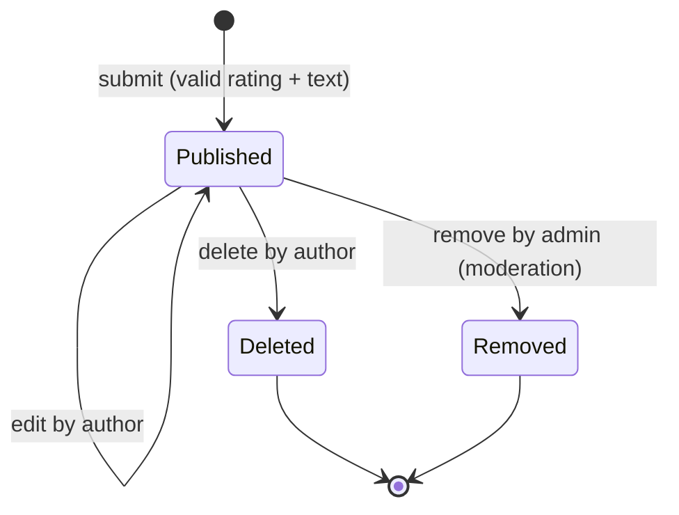
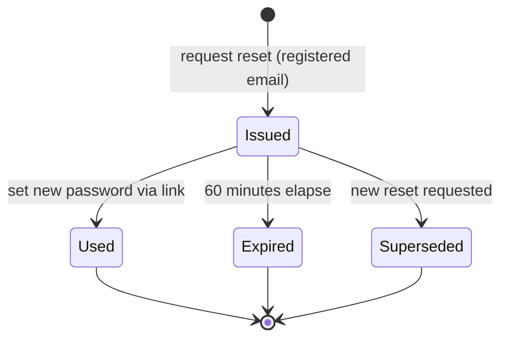
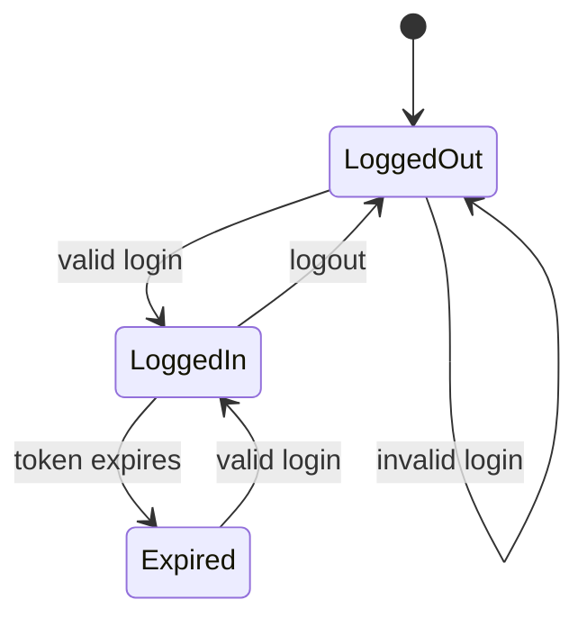

# Test Plan — HotelTrivago

**Milestone**: M3 — Black Box Testing
**Author**: Gilberto Anaya Mercado (QA Lead)
**Last updated**: 2026-10-26
**Status**: Draft — pending team review

See the [Test Strategy](./test-strategy.md) for scope, levels, environments and entry/exit criteria.

---

## 1. Features to Test

Feature IDs reuse the requirement IDs from the specification.

| Feature ID | Feature                                   | Priority | Portal   | Test Techniques             | Test Cases                     |
| ---------- | ----------------------------------------- | -------- | -------- | --------------------------- | ------------------------------ |
| FR-1       | User registration                         | High     | Client   | EP, BVA                     | TC-001 – TC-004                |
| FR-2       | Login / logout                            | High     | Both     | EP, ST                      | TC-005, TC-006                 |
| FR-3       | Password reset via email link             | Medium   | Client   | ST                          | TC-007, TC-008                 |
| FR-4       | Search by destination, dates, guests, rooms | High   | Client   | EP, BVA                     | TC-009 – TC-013                |
| FR-5       | Filter results                            | High     | Client   | EP, BVA                     | TC-014, TC-015                 |
| FR-6       | Sort results                              | Medium   | Client   | EP                          | TC-016                         |
| FR-7       | Hotel detail page                         | Medium   | Client   | EP                          | TC-017                         |
| FR-8       | Compare provider prices                   | High     | Client   | DT                          | TC-018 – TC-021                |
| FR-9       | Redirect to provider                      | High     | Client   | EP                          | TC-022                         |
| FR-10      | Results on interactive map                | Low      | Client   | EP                          | TC-023                         |
| FR-11      | Favorites list                            | Medium   | Client   | EP                          | TC-024                         |
| FR-12      | Recent search history                     | Low      | Client   | BVA                         | TC-025                         |
| FR-13      | Ratings and reviews                       | Medium   | Client   | BVA, ST, DT                 | TC-026 – TC-030                |
| FR-14      | Admin hotel management (CRUD)             | High     | Employee | EP, DT                      | TC-031, TC-032                 |
| FR-15      | Admin providers & review moderation       | Medium   | Employee | ST, DT                      | TC-020, TC-033                 |
| NFR-SEC    | Input sanitization, RBAC, hashing         | High     | Both     | Error guessing, DT          | TC-001, TC-032, TC-036         |
| NFR-USA    | Error messages, empty states, loading     | Medium   | Both     | EP                          | TC-013, TC-034, TC-035         |
| NFR-REL    | Partial results when a provider fails     | High     | Client   | DT                          | TC-019, TC-021                 |

**Priority meaning**: *High* = core flow or security, must pass before any release; *Medium* = important but has workaround; *Low* = nice-to-have for the demo.

---

## 2. Test Items and Interfaces

| Interface                 | How it is tested                                                      |
| ------------------------- | --------------------------------------------------------------------- |
| Client portal (`/client/`)  | Manual execution now; Playwright E2E in M6                          |
| Employee portal (`/employee/`) | Manual execution now; Playwright E2E in M6                       |
| REST API (`:8000`)        | API-level steps where the UI is not needed; pytest integration in M4  |
| MongoDB                   | Verification of persisted state (favorites, reviews, history)         |
| Provider stubs            | Configurable responses: OK, no availability, timeout, HTTP 500        |

---

## 3. Assumed Business Rules

The requirements do not define these limits. They are **assumptions to be confirmed** by the Project Manager and Backend Lead (see Open Questions in the strategy). Test cases reference them by ID.

| ID    | Rule                                                                                                   | Used by                 |
| ----- | ------------------------------------------------------------------------------------------------------ | ----------------------- |
| BR-01 | Password length **8–64** characters, with at least one letter and one digit.                           | TC-003                  |
| BR-02 | Check-in date must be **today or later** (server date).                                                | TC-010                  |
| BR-03 | Stay length (check-out − check-in) must be **1–30 nights**.                                            | TC-010                  |
| BR-04 | Guests per search **1–10**; rooms **1–5**; rooms cannot exceed guests.                                 | TC-011, TC-012          |
| BR-05 | Price filter: `0 ≤ min ≤ max`; bounds are **inclusive**.                                               | TC-014                  |
| BR-06 | Review rating is an integer **1–5**; review text **10–1000** characters; **one review per user per hotel**. | TC-026, TC-027, TC-029 |
| BR-07 | Search history keeps the **10 most recent** searches per user (oldest evicted first).                  | TC-025                  |
| BR-08 | Password reset link is **single use**, valid for **60 minutes**, and a new request invalidates previous links. | TC-007, TC-008   |
| BR-09 | Provider prices are cached for **15 minutes** (from NFR Performance); a provider that fails is omitted, the rest are still shown (NFR Reliability). | TC-018 – TC-021 |

---

## 4. Test Design Techniques

### 4.1 Equivalence Partitioning (EP)

| Input                | Valid partitions                                   | Invalid partitions                                                    | Test Cases     |
| -------------------- | -------------------------------------------------- | --------------------------------------------------------------------- | -------------- |
| Email (registration) | Well-formed, not registered                        | Missing `@`; missing domain; spaces; empty; already registered        | TC-001, TC-002, TC-004 |
| Login credentials    | Registered email + correct password                | Unknown email; wrong password; empty fields; injection payload       | TC-005, TC-006, TC-036 |
| Destination          | Known city with hotels                             | Empty / whitespace only; known city with no hotels (empty state); unknown text | TC-009, TC-013 |
| Filters              | Single filter; combined filters (AND)              | Combination with no matches (empty state)                            | TC-015         |
| Sort option          | price asc, price desc, rating, distance, popularity | Unsupported value via API (`sort=foo`)                               | TC-016         |
| Hotel ID             | Existing hotel                                     | Non-existent ID; malformed ID                                        | TC-017         |
| Hotel form (admin)   | All required fields valid                          | Missing name; missing location; invalid star rating                  | TC-031         |
| Favorite action      | Add new; remove existing                           | Add duplicate; anonymous user                                        | TC-024         |
| Map data             | Hotel with coordinates                             | Hotel without coordinates                                            | TC-023         |

### 4.2 Boundary Value Analysis (BVA)

| Input                     | Min boundary tests | Max boundary tests | Rule  | Test Case |
| ------------------------- | ------------------ | ------------------ | ----- | --------- |
| Password length           | 7 ✗, 8 ✓           | 64 ✓, 65 ✗         | BR-01 | TC-003    |
| Check-in date             | TODAY−1 ✗, TODAY ✓ | —                  | BR-02 | TC-010    |
| Nights                    | 0 ✗, 1 ✓           | 30 ✓, 31 ✗         | BR-03 | TC-010    |
| Guests                    | 0 ✗, 1 ✓           | 10 ✓, 11 ✗         | BR-04 | TC-011    |
| Rooms                     | 0 ✗, 1 ✓           | 5 ✓, 6 ✗; rooms = guests ✓, rooms = guests + 1 ✗ | BR-04 | TC-012 |
| Price range               | min −1 ✗, min 0 ✓  | price = max ✓ (inclusive), price = max + 1 excluded; min = max ✓; min > max ✗ | BR-05 | TC-014 |
| Review rating             | 0 ✗, 1 ✓           | 5 ✓, 6 ✗           | BR-06 | TC-026    |
| Review text length        | 9 ✗, 10 ✓          | 1000 ✓, 1001 ✗     | BR-06 | TC-027    |
| Search history size       | —                  | 10th kept ✓, 11th evicts oldest | BR-07 | TC-025 |
| Provider cache age        | 14:59 min → cached | 15:00 min → refreshed | BR-09 | TC-018, TC-020 |

### 4.3 Decision Tables (DT)

#### DT-1 — Provider price display (FR-8, FR-15, NFR Reliability, BR-09)

Evaluated **per provider** for a hotel detail / comparison view.

| Conditions                              | R1  | R2  | R3  | R4  | R5 (all providers) |
| --------------------------------------- | --- | --- | --- | --- | ------------------ |
| Cached price younger than 15 min        | Y   | N   | N   | N   | N                  |
| Provider API responds successfully      | –   | Y   | Y   | N   | N (every provider) |
| Provider has availability for the dates | –   | Y   | N   | –   | –                  |
| **Actions**                             |     |     |     |     |                    |
| Show price from cache (no API call)     | ✅  |     |     |     |                    |
| Call provider and show live price       |     | ✅  |     |     |                    |
| Update cache timestamp                  |     | ✅  |     |     |                    |
| Show provider as "Not available"        |     |     | ✅  |     |                    |
| Omit provider, keep the others          |     |     |     | ✅  |                    |
| Show "Prices temporarily unavailable" message, hotel info still visible |  |  |  |  | ✅ |
| **Test Case**                           | TC-018 | TC-020 | TC-018 | TC-019 | TC-021        |

#### DT-2 — Review action permissions (FR-13, FR-15, BR-06)

| Conditions                         | R1  | R2  | R3  | R4  | R5  |
| ---------------------------------- | --- | --- | --- | --- | --- |
| User authenticated                 | N   | Y   | Y   | Y   | Y   |
| User is the review author          | –   | N   | Y   | N   | –   |
| User is admin                      | –   | N   | N   | Y   | N   |
| User already reviewed this hotel   | –   | –   | –   | –   | Y   |
| **Actions**                        |     |     |     |     |     |
| Read reviews                       | ✅  | ✅  | ✅  | ✅  | ✅  |
| Create review → login prompt / 401 | ✅  |     |     |     |     |
| Edit/delete review → 403           |     | ✅  |     |     |     |
| Edit/delete own review allowed     |     |     | ✅  |     |     |
| Remove (moderate) review allowed; edit text → 403 |  |  |  | ✅ |  |
| Create second review → rejected (409) |  |   |     |     | ✅  |
| **Test Case**                      | TC-029 | TC-029 | TC-028 | TC-033 | TC-029 |

#### DT-3 — Admin route access (FR-14, FR-15, NFR Security RBAC)

| Conditions                         | R1  | R2  | R3  | R4  |
| ---------------------------------- | --- | --- | --- | --- |
| Auth token present                 | N   | Y   | Y   | Y   |
| Token valid (not expired/tampered) | –   | N   | Y   | Y   |
| Role is admin                      | –   | –   | N   | Y   |
| **Actions**                        |     |     |     |     |
| 401 Unauthorized / redirect to login | ✅ | ✅ |    |     |
| 403 Forbidden                      |     |     | ✅  |     |
| Access granted                     |     |     |     | ✅  |
| **Test Case**                      | TC-032 | TC-032 | TC-032 | TC-031, TC-032 |

### 4.4 State Transition (ST)

Diagram sources are also stored in [`diagrams/`](./diagrams/) (Mermaid, rendered by GitHub).

#### ST-1 — Review lifecycle (FR-13, FR-15)

| #   | From      | Event                       | To        | Valid? | Test Case |
| --- | --------- | --------------------------- | --------- | ------ | --------- |
| 1   | (none)    | submit                      | Published | ✅     | TC-028    |
| 2   | Published | edit by author              | Published | ✅     | TC-028    |
| 3   | Published | delete by author            | Deleted   | ✅     | TC-028    |
| 4   | Published | remove by admin             | Removed   | ✅     | TC-033    |
| 5   | Published | submit second review (same user/hotel) | — (rejected) | ❌ | TC-029 |
| 6   | Removed   | edit by author              | — (rejected) | ❌  | TC-033    |
| 7   | Deleted   | edit / delete again         | — (404)   | ❌     | TC-028    |
| 8   | Published | (logout / server restart)   | Published | ✅ persists | TC-030 |

#### ST-2 — Password reset token (FR-3, BR-08)

| #   | From       | Event                    | To          | Valid? | Test Case |
| --- | ---------- | ------------------------ | ----------- | ------ | --------- |
| 1   | (none)     | request reset            | Issued      | ✅     | TC-007    |
| 2   | Issued     | set new password         | Used        | ✅     | TC-007    |
| 3   | Used       | open link again          | — (rejected) | ❌    | TC-008    |
| 4   | Issued     | 60 min elapse, open link | Expired → rejected | ❌ | TC-008 |
| 5   | Issued     | new reset requested, open old link | Superseded → rejected | ❌ | TC-008 |

#### ST-3 — User session (FR-2)

| #   | From      | Event                          | To        | Valid? | Test Case |
| --- | --------- | ------------------------------ | --------- | ------ | --------- |
| 1   | LoggedOut | valid login                    | LoggedIn  | ✅     | TC-005    |
| 2   | LoggedOut | invalid login                  | LoggedOut | ✅     | TC-006    |
| 3   | LoggedIn  | logout                         | LoggedOut | ✅     | TC-005    |
| 4   | LoggedOut | reuse old token on protected route | — (401) | ❌   | TC-005    |
| 5   | LoggedIn  | token expires, access favorites | Expired → login required | ❌ | TC-024 |

---

## 5. Test Case Summary

| Category                     | Test Cases        | Count |
| ---------------------------- | ----------------- | ----- |
| User authentication          | TC-001 – TC-008   | 8     |
| Search, filter, sort, detail | TC-009 – TC-017   | 9     |
| Price comparison & redirect  | TC-018 – TC-022   | 5     |
| Map, favorites, history      | TC-023 – TC-025   | 3     |
| Reviews                      | TC-026 – TC-030   | 5     |
| Admin                        | TC-031 – TC-033   | 3     |
| Error handling & security    | TC-034 – TC-036   | 3     |
| **Total**                    |                   | **36** |

| Technique         | Test Cases                                                         | Count |
| ----------------- | ------------------------------------------------------------------ | ----- |
| EP                | TC-001, 002, 004, 006, 009, 013, 015, 016, 017, 022, 023, 024, 031, 034, 035, 036 | 16 |
| BVA               | TC-003, 010, 011, 012, 014, 025, 026, 027                          | 8     |
| Decision Table    | TC-018, 019, 020, 021, 029, 032                                    | 6     |
| State Transition  | TC-005, 007, 008, 028, 030, 033                                    | 6     |

---

## 6. Schedule

| Activity                                   | Milestone | Depends on                         |
| ------------------------------------------ | --------- | ---------------------------------- |
| Review of this plan and BR confirmation    | M3        | Team meeting                       |
| Manual execution of High priority cases    | M4        | Features merged into `beta`        |
| Automation of API-level cases (pytest)     | M4        | API contract + backend endpoints   |
| Automation of user journeys (Playwright, POM, Gherkin) | M6 | Client and Employee portals   |
| Performance tests on search (JMeter)       | M7        | Deployed environment               |

---

## 7. Deliverables

- `docs/milestones/M3/test-strategy.md`
- `docs/milestones/M3/test-plan.md` (this document)
- `docs/milestones/M3/test-cases.md`
- `docs/milestones/M3/traceability-matrix.md`
- `docs/milestones/M3/diagrams/` (state transition sources)
- `tests/data/` (test data documentation and CSV data sets)
